<picture><source media="(prefers-color-scheme: dark)" srcset="assets/hero-dark.svg"><source media="(prefers-color-scheme: light)" srcset="assets/hero-light.svg"></picture>

  <a href="#about"><picture><source media="(prefers-color-scheme: dark)" srcset="assets/nav-about-dark.svg"><source media="(prefers-color-scheme: light)" srcset="assets/nav-about-light.svg">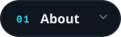</picture></a>
  <a href="#stack"><picture><source media="(prefers-color-scheme: dark)" srcset="assets/nav-stack-dark.svg"><source media="(prefers-color-scheme: light)" srcset="assets/nav-stack-light.svg">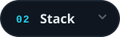</picture></a>
  <a href="#projects"><picture><source media="(prefers-color-scheme: dark)" srcset="assets/nav-projects-dark.svg"><source media="(prefers-color-scheme: light)" srcset="assets/nav-projects-light.svg">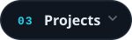</picture></a>
  <a href="#activity"><picture><source media="(prefers-color-scheme: dark)" srcset="assets/nav-activity-dark.svg"><source media="(prefers-color-scheme: light)" srcset="assets/nav-activity-light.svg">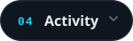</picture></a>
  <a href="#contact"><picture><source media="(prefers-color-scheme: dark)" srcset="assets/nav-contact-dark.svg"><source media="(prefers-color-scheme: light)" srcset="assets/nav-contact-light.svg">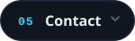</picture></a>

<picture><source media="(prefers-color-scheme: dark)" srcset="assets/h-about-dark.svg"><source media="(prefers-color-scheme: light)" srcset="assets/h-about-light.svg"></picture>

AI engineer working mostly in **Python**. I build LLM-powered systems: **agents, RAG pipelines, evaluation infrastructure** and the automation around them. Working professionally since 2021, currently as a full-stack automation engineer, with freelance projects on the side.

<picture><source media="(prefers-color-scheme: dark)" srcset="assets/about-dark.svg"><source media="(prefers-color-scheme: light)" srcset="assets/about-light.svg"></picture>

<picture><source media="(prefers-color-scheme: dark)" srcset="assets/h-stack-dark.svg"><source media="(prefers-color-scheme: light)" srcset="assets/h-stack-light.svg"></picture>

<picture><source media="(prefers-color-scheme: dark)" srcset="assets/stack-dark.svg"><source media="(prefers-color-scheme: light)" srcset="assets/stack-light.svg">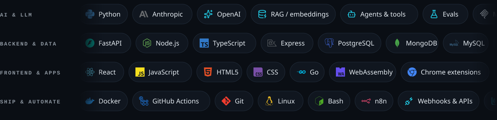</picture>

<picture><source media="(prefers-color-scheme: dark)" srcset="assets/h-projects-dark.svg"><source media="(prefers-color-scheme: light)" srcset="assets/h-projects-light.svg"></picture>

<a href="https://github.com/amirshahzadhashmi7145/atelier"><picture><source media="(prefers-color-scheme: dark)" srcset="assets/feature-atelier-dark.svg"><source media="(prefers-color-scheme: light)" srcset="assets/feature-atelier-light.svg"></picture></a> <a href="https://github.com/amirshahzadhashmi7145/atelier"><picture><source media="(prefers-color-scheme: dark)" srcset="assets/link-atelier-repo-dark.svg"><source media="(prefers-color-scheme: light)" srcset="assets/link-atelier-repo-light.svg">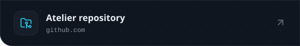</picture></a><a href="https://github.com/amirshahzadhashmi7145/Atelier-V2"><picture><source media="(prefers-color-scheme: dark)" srcset="assets/link-atelier-v2-dark.svg"><source media="(prefers-color-scheme: light)" srcset="assets/link-atelier-v2-light.svg">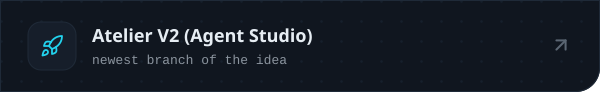</picture></a>

  <a href="https://github.com/amirshahzadhashmi7145/agentrewind"><picture><source media="(prefers-color-scheme: dark)" srcset="assets/card-agentrewind-dark.svg"><source media="(prefers-color-scheme: light)" srcset="assets/card-agentrewind-light.svg"></picture></a>
  <a href="https://github.com/amirshahzadhashmi7145/dbport"><picture><source media="(prefers-color-scheme: dark)" srcset="assets/card-dbport-dark.svg"><source media="(prefers-color-scheme: light)" srcset="assets/card-dbport-light.svg"></picture></a>

  <a href="https://github.com/amirshahzadhashmi7145/NexJob"><picture><source media="(prefers-color-scheme: dark)" srcset="assets/card-nexjob-dark.svg"><source media="(prefers-color-scheme: light)" srcset="assets/card-nexjob-light.svg"></picture></a>
  <a href="https://github.com/amirshahzadhashmi7145/ryxogo"><picture><source media="(prefers-color-scheme: dark)" srcset="assets/card-ryxogo-dark.svg"><source media="(prefers-color-scheme: light)" srcset="assets/card-ryxogo-light.svg"></picture></a>

  <picture><source media="(prefers-color-scheme: dark)" srcset="assets/card-tradebot-dark.svg"><source media="(prefers-color-scheme: light)" srcset="assets/card-tradebot-light.svg"></picture>
  <a href="https://github.com/Kerneta/daidocs"><picture><source media="(prefers-color-scheme: dark)" srcset="assets/card-dai-dark.svg"><source media="(prefers-color-scheme: light)" srcset="assets/card-dai-light.svg"></picture></a>

<picture><source media="(prefers-color-scheme: dark)" srcset="assets/h-activity-dark.svg"><source media="(prefers-color-scheme: light)" srcset="assets/h-activity-light.svg"></picture>

  <picture>
    <source media="(prefers-color-scheme: dark)" srcset="https://raw.githubusercontent.com/amirshahzadhashmi7145/amirshahzadhashmi7145/output/activity-dark.svg">
    <source media="(prefers-color-scheme: light)" srcset="https://raw.githubusercontent.com/amirshahzadhashmi7145/amirshahzadhashmi7145/output/activity-light.svg">
    
  </picture>

  <picture>
    <source media="(prefers-color-scheme: dark)" srcset="https://raw.githubusercontent.com/amirshahzadhashmi7145/amirshahzadhashmi7145/output/snake-card-dark.svg">
    <source media="(prefers-color-scheme: light)" srcset="https://raw.githubusercontent.com/amirshahzadhashmi7145/amirshahzadhashmi7145/output/snake-card-light.svg">
    
  </picture>

<picture><source media="(prefers-color-scheme: dark)" srcset="assets/h-contact-dark.svg"><source media="(prefers-color-scheme: light)" srcset="assets/h-contact-light.svg"></picture>

<a href="https://www.linkedin.com/in/amir-shahzad-hashmi/"><picture><source media="(prefers-color-scheme: dark)" srcset="assets/cta-dark.svg"><source media="(prefers-color-scheme: light)" srcset="assets/cta-light.svg"></picture></a> <a href="https://www.linkedin.com/in/amir-shahzad-hashmi/"><picture><source media="(prefers-color-scheme: dark)" srcset="assets/social-linkedin-dark.svg"><source media="(prefers-color-scheme: light)" srcset="assets/social-linkedin-light.svg">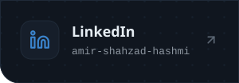</picture></a><a href="mailto:amirshahzadhashmi7145@gmail.com"><picture><source media="(prefers-color-scheme: dark)" srcset="assets/social-email-dark.svg"><source media="(prefers-color-scheme: light)" srcset="assets/social-email-light.svg">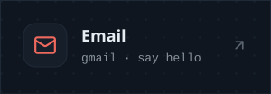</picture></a><a href="https://amirshahzadhashmi7145.github.io/Amir-Portfolio/"><picture><source media="(prefers-color-scheme: dark)" srcset="assets/social-portfolio-dark.svg"><source media="(prefers-color-scheme: light)" srcset="assets/social-portfolio-light.svg">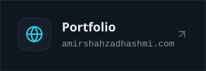</picture></a><a href="https://leetcode.com/amirshahzadhashmi7145/"><picture><source media="(prefers-color-scheme: dark)" srcset="assets/social-leetcode-dark.svg"><source media="(prefers-color-scheme: light)" srcset="assets/social-leetcode-light.svg">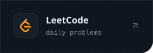</picture></a>

<!--
  Everything above is generated. Edit scripts/profile.mjs, run `node scripts/build-svgs.mjs`, commit.
  The activity and snake cards are rebuilt by .github/workflows/snake.yml and served from the output branch.
  Icons: Simple Icons (CC0) and Lucide (ISC); licenses in scripts/.
-->
